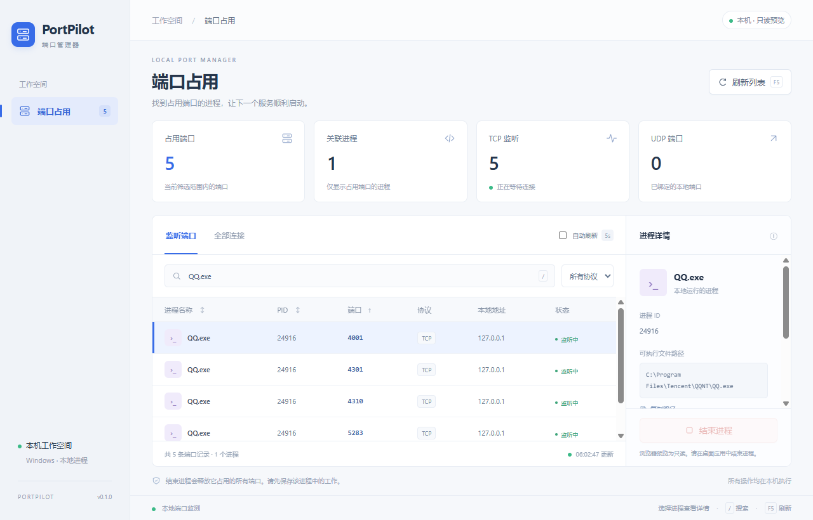

# PortPilot · 端口管理器

一个类似 Windows 任务管理器的轻量端口管理工具。只显示占用端口的进程，帮助开发者快速定位「端口已被占用」的问题，查看进程信息，并在确认后结束进程、释放端口。

使用 Go 和 [MyGo](https://mygo.egoist.dev/) 构建，直接调用 Windows API 读取真实端口数据。

## 界面截图



截图为使用真实本机数据的只读浏览器预览。桌面应用通过 MyGo IPC 提供结束进程功能；浏览器预览不允许结束进程。

## 下载与安装

从 [GitHub Releases](https://github.com/zhengchalei/port-kill/releases/latest) 下载 `PortPilot-windows-amd64.zip`，解压后直接运行 `PortPilot.exe`。

需要桌面快捷方式时，在解压目录运行：

```powershell
powershell -ExecutionPolicy Bypass -File .\install.ps1
```

安装脚本仅对此次执行设置策略，复制程序到 `%LOCALAPPDATA%\Programs\PortPilot`，并创建桌面「PortPilot 端口管理器」快捷方式。无需管理员权限。卸载时删除该目录和快捷方式即可。

支持 Windows 10 / 11（amd64），需要 WebView2 Runtime。当前版本未做代码签名。

## 使用

双击 `build/PortPilot.exe`。选择端口记录，在右侧查看进程路径、PID、关联端口，点击「结束进程」并确认。

- 默认显示 TCP 监听端口和 UDP 绑定端口，支持切换全部 TCP 连接。
- 覆盖 IPv4 / IPv6；按端口、进程名称、PID、地址搜索，按名称、PID、端口排序。
- 每 5 秒自动刷新，可暂停；`/` 聚焦搜索，`F5` 刷新。
- 结束的是整个进程，因此会关闭它的全部连接。操作前显示受影响端口。
- 系统关键进程、不可访问进程和应用自身受保护。结束时校验进程创建时间和端口归属，防止 PID 重用误杀。
- 普通权限即可查看。操作权限受 Windows 限制，需要时自行以管理员身份运行。

## 开发与验证

需要 Go 1.27.1（支持 Go 自动下载工具链）以及 Windows WebView2 Runtime。Windows 11 通常已包含 WebView2。

```powershell
go run .
go test ./... -v
go vet ./...
go build -ldflags="-H windowsgui -s -w" -o build/PortPilot.exe .
```

无前端包管理器依赖；HTML、CSS、JavaScript 直接嵌入可执行文件，通过 MyGo IPC 调用 Go 服务。端口读取使用 Windows IP Helper API，不执行 shell 命令。

只读浏览器预览：

```powershell
go run . --preview 127.0.0.1:8787
```

预览使用真实本机数据，但不提供结束进程接口。桌面版通过 MyGo IPC 执行结束操作。

```powershell
go run . --snapshot
```

测试仅结束测试自己创建的临时进程，并验证其 TCP / UDP 端口能够重新绑定。当前提供 Windows amd64 可执行文件，未签名。
